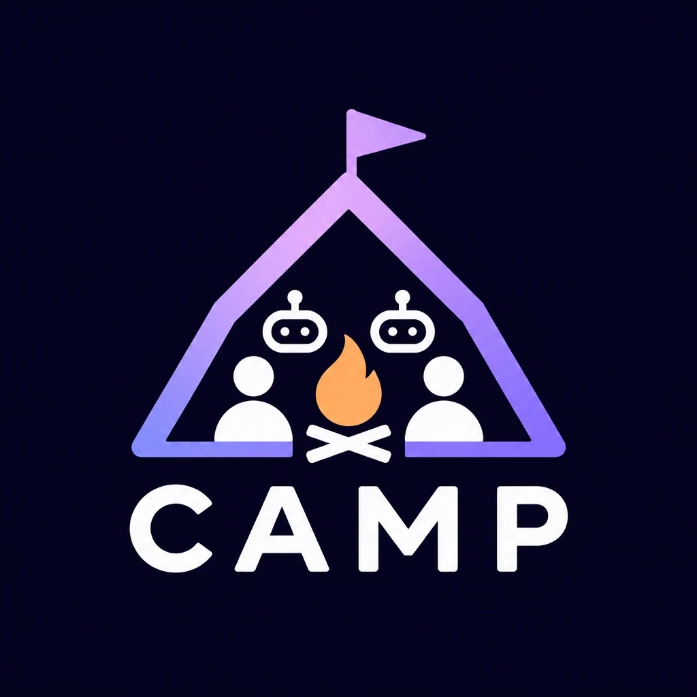

<p align="center"></p>

# @camp-protocol/kit — Collaborative Agent Mediation Protocol

[English](README.md) | 日本語

数人が同じ画面を同時に操作し、そこに AI の遅い処理が割り込んでくるアプリのための、WebSocket 上のアプリケーション層プロトコルとその実装です。

WebSocket は「1対1で届ける」だけです。CAMP はその上で次を決めて、実装しています。

| 決めること | CAMP |
|---|---|
| 誰が先か | サーバーが部屋ごとに1件ずつ処理し、連番 `seq` を振って全員に同じ順番で配る |
| 失敗の返し方 | 操作（Command）には必ず成否と理由コードが返る |
| 二度押し・再送 | `commandId` で重複を排除し、同じ結果を返す |
| 切断 | 自動で再接続し、同じ参加者として状態の全体を取り直す（本人にだけ渡す合言葉で戻るので、ほかの人は席を奪えない）。返事の来ていない操作は送り直す |
| AI の遅い結果 | `room.task()` で走らせ、`room.reset()` をまたいだ結果は捨てる |
| 高頻度の情報 | カーソルなどは Ephemeral（保存しない・最新だけ）、「うーん」などは Signal（返事なし・間引く） |
| バージョン違い・壊れたメッセージ・送りすぎ | 理由を返して、決まった終了コードで閉じる |

仕様書：[SPEC.md](SPEC.md)（英語）

## 使い方

### 1. 語彙を決める（サーバーと画面で共有）

```ts
import { z } from 'zod';
import { defineVocabulary } from '@camp-protocol/kit';

export const quickVote = defineVocabulary({
  commands: {
    OPEN_POLL: z.object({ question: z.string(), options: z.array(z.string()).min(2) }),
    VOTE: z.object({ option: z.number().int() }),
    CLOSE_POLL: z.object({}),
  },
  events: ['POLL_OPENED', 'VOTED', 'POLL_CLOSED', 'SUMMARY_READY'],
  rejectReasons: ['NOT_HOST', 'POLL_NOT_OPEN', 'ALREADY_VOTED'],
  snapshot: z.object({ seq: z.number(), status: z.string(), votes: z.record(z.string(), z.number()), summary: z.string().nullable() /* … */ }),
  signals: { HMM: z.object({}) },
});
```

### 2. サーバー：操作ごとのルールだけ書く

```ts
import { createCampServer } from '@camp-protocol/kit/server';

createCampServer(quickVote, {
  port: 8790,
  room: {
    initialState: () => ({ status: 'idle', question: '', options: [], votes: {}, summary: null }),
    commands: {
      VOTE(room, { option }, { actor }) {
        if (room.state.status !== 'open') return room.reject('POLL_NOT_OPEN');
        if (actor in room.state.votes) return room.reject('ALREADY_VOTED');
        room.state.votes[actor] = option;
        room.emit('VOTED', { by: actor });                 // 連番と状態の全体つきで全員へ
      },
      CLOSE_POLL(room, _p, { actor }) {
        if (!room.isHost(actor)) return room.reject('NOT_HOST');
        room.state.status = 'closed';
        room.emit('POLL_CLOSED', {});
        room.task(() => ai.summarize(room.state), (summary) => {   // 遅い AI
          room.state.summary = summary;
          room.emit('SUMMARY_READY', {});
        });
      },
    },
  },
});
```

### 3. 画面：送る・受け取るだけ

```ts
import { CampClient } from '@camp-protocol/kit/client';

const camp = new CampClient(quickVote, { url: 'wss://example.com/camp', room: 'class-3b' })
  .on({ onSnapshot: (s) => render(s) })       // 届いた状態をそのまま描く
  .connect();

const r = await camp.send('VOTE', { option: 1 });
if (!r.ok) alert(r.reason);                   // 'ALREADY_VOTED' など
camp.signal('HMM', {});                        // 返事のいらない反応
```

Node で使うときは `createSocket: (url) => new WebSocket(url)`（`ws` パッケージ）を渡します。

### リンクで入る部屋（会議のリンクと同じ）

既定では、入ってきた人がいれば部屋を作ります（試すのに便利）。招待した人だけを入れるなら、それを止めてリンクを配ります。

```ts
const server = createCampServer(quickVote, { port: 8790, autoCreateRooms: false, room: { /* … */ } });
const roomId = server.createRoom();            // 例 "kqd-rmzw-tbe"（推測されにくい ID）
sendInvite(`https://example.com/r/${roomId}`); // リンクを開いた人が入れる

camp.on({ onRoomNotFound: () => showNotFound() }); // 違う・期限切れのリンク。再接続はしない
```

`createCampServer` が持つ部屋は `maxRooms`（既定 100）まで。でたらめな部屋 ID で入られても、メモリを使い切られません。

### ページを開き直しても同じ人として戻る

ページを開いているあいだは、クライアントが自動でつなぎ直します。開き直したあとも同じ参加者として戻るには、welcome でもらった ID と合言葉（`resumeToken`）を両方保存して渡します。参加者 ID は snapshot で全員に見えますが、合言葉は本人にだけ送られます。自前の `RoomEndpoint` では、`@camp-protocol/kit/server` の `createResumeToken()` と `resumeTokenMatches()` を同じように使います。

```ts
camp.on({ onWelcome: () => sessionStorage.setItem('camp', JSON.stringify({ id: camp.id, token: camp.resumeToken })) });
const saved = JSON.parse(sessionStorage.getItem('camp') ?? 'null');
new CampClient(vocabulary, { url, room, participantId: saved?.id, resumeToken: saved?.token });
```

### 状態を保存したい・独自の処理順が要るとき

`createCampTransport({ vocabulary, rooms })` に、`RoomEndpoint`（attach / detach / receiveCommand / receiveEphemeral / receiveSignal）を実装した自分の部屋を渡します。たとえば IDEA AUDITION の `SessionActor` はこの形で、Firestore への保存・AI の生成計画・合意台帳を持っています。

## 例

- [examples/quick-vote](examples/quick-vote)：みんなで投票（ホスト・投票・締め切り・遅い AI のまとめ・「うーん」）
  - `npx tsx examples/quick-vote/server.ts` を起動して、別の端末で `npx tsx examples/quick-vote/demo.ts`
- IDEA AUDITION：4人の審査員と AI キャラクターが企画を決めるアプリ。CAMP はここから生まれた

## 構成

| 入口 | 中身 | 動く場所 |
|---|---|---|
| `@camp-protocol/kit` | 版・終了コード、封筒、`defineVocabulary`、`ResultCache`、`SeqGate` | どこでも（zod だけに依存） |
| `@camp-protocol/kit/client` | 再接続・再送・順序つきのクライアント | ブラウザ・Node |
| `@camp-protocol/kit/server` | WebSocket の終端（`createCampTransport`）、すぐ使える部屋（`CampRoom`）、`createCampServer` | Node（ws） |

## テスト

`pnpm test`：境界（アプリに依存しない・クライアントが Node 専用のものを使わない）と、Quick Vote での同時操作・拒否・再送・再接続・合言葉なしでは他人として戻れない・遅い AI（結果の反映で例外が出てもサーバーが止まらない）・観覧・Signal・版違い・部屋の数の上限。

## 向いている規模と、アプリに任せること

- イベントのたびに状態の全体を配るので、会議・授業・ゲームの卓くらいの少人数の部屋に向く（数千人・巨大な状態には向かない）
- ログイン（誰なのか）は CAMP の外。WebSocket の upgrade の前か、部屋の登録（RoomRegistry）で確かめる

## 状態

0.1.0。作者は牧 夢斗（[@yuto-valiark](https://github.com/yuto-valiark)）。IDEA AUDITION（DevFest Hackathon 2026、チーム VICTORY）の中から生まれ、そのアプリで使っています。0.x の間は破壊的な変更がありえます。

## ライセンス

[MIT](LICENSE)
