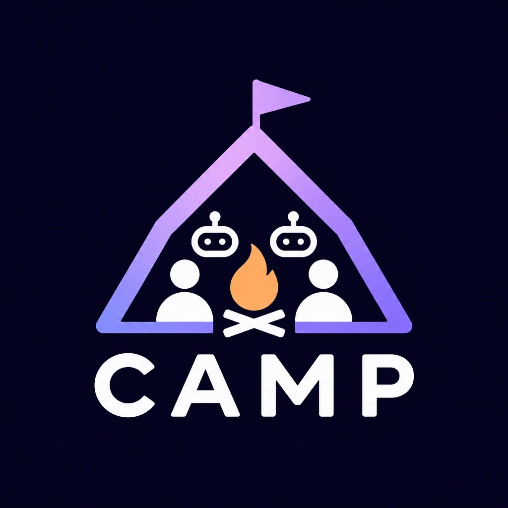

<p align="center"></p>

# CAMP — Collaborative Agent Mediation Protocol

English | [日本語](README.ja.md)

**A shared decision layer for humans and AI agents.**

CAMP is an application-layer protocol on top of WebSocket, plus a TypeScript implementation (`@camp-protocol/kit`).
It is for rooms where **several people act at the same time and slow AI results arrive in between**, and every screen still has to agree on what happened.

WebSocket only delivers bytes, one connection at a time. Every realtime app ends up writing the same rules on top of it, a little differently each time. CAMP writes those rules down once.

| Question | What CAMP does |
|---|---|
| Who went first? | The server processes one message at a time per room, numbers every change with `seq`, and sends changes to everyone in the same order |
| Did my action work? | Every command gets a `result`: `ok`, or a reason code the UI can show |
| Double clicks, retries | Commands carry a `commandId`. Duplicates are not run again; the first result is returned |
| Disconnects | The client reconnects with backoff, comes back as the same participant (with a secret resume token, so nobody else can take the seat), gets the full state, and resends commands that never got a result |
| Slow AI results | `room.task()` runs the work. If the room was reset while the AI was thinking, the old result is thrown away |
| "Was it still the same version?" | Commands can say which version they were looking at (`expected.rev`). The server can turn down stale ones with `STALE_VERSION` |
| Who may enter | Rooms the app created, joined by link (`randomRoomId()` gives Meet-style IDs). Unknown rooms get `ROOM_NOT_FOUND` |
| Cursors, "hmm…" | Ephemerals (not stored, latest wins) and Signals (no reply, thinned out per person) |
| Wrong version, broken messages, flooding | A `protocol_error` with a reason, then a fixed close code |

The spec is in [SPEC.md](SPEC.md).

## Install

```bash
npm install @camp-protocol/kit zod
```

ESM only. Requires Node.js 20 or later on the server; the client also runs in browsers.

## Quick start

### 1. Define your vocabulary (shared by server and UI)

```ts
import { z } from 'zod';
import { defineVocabulary } from '@camp-protocol/kit';

export const quickVote = defineVocabulary({
  commands: {
    OPEN_POLL: z.object({ question: z.string(), options: z.array(z.string()).min(2) }),
    VOTE: z.object({ option: z.number().int() }),
    CLOSE_POLL: z.object({}),
  },
  events: ['POLL_OPENED', 'VOTED', 'POLL_CLOSED', 'SUMMARY_READY'],
  rejectReasons: ['NOT_HOST', 'POLL_NOT_OPEN', 'ALREADY_VOTED'],
  snapshot: z.object({ seq: z.number(), status: z.string(), votes: z.record(z.string(), z.number()), summary: z.string().nullable() /* … */ }),
  signals: { HMM: z.object({}) },
});
```

### 2. Server: write only your rules

```ts
import { createCampServer } from '@camp-protocol/kit/server';

createCampServer(quickVote, {
  port: 8790,
  room: {
    initialState: () => ({ status: 'idle', question: '', options: [], votes: {}, summary: null }),
    commands: {
      VOTE(room, { option }, { actor }) {
        if (room.state.status !== 'open') return room.reject('POLL_NOT_OPEN');
        if (actor in room.state.votes) return room.reject('ALREADY_VOTED');
        room.state.votes[actor] = option;
        room.emit('VOTED', { by: actor });            // numbered, with the full state, to everyone
      },
      CLOSE_POLL(room, _p, { actor }) {
        if (!room.isHost(actor)) return room.reject('NOT_HOST');
        room.state.status = 'closed';
        room.emit('POLL_CLOSED', {});
        room.task(() => ai.summarize(room.state), (summary) => {   // slow AI
          room.state.summary = summary;
          room.emit('SUMMARY_READY', {});
        });
      },
    },
  },
});
```

### 3. UI: send and render

```ts
import { CampClient } from '@camp-protocol/kit/client';

const camp = new CampClient(quickVote, { url: 'wss://example.com/camp', room: 'class-3b' })
  .on({ onSnapshot: (s) => render(s) })      // just draw the state you get
  .connect();

const r = await camp.send('VOTE', { option: 1 });
if (!r.ok) alert(r.reason);                  // e.g. 'ALREADY_VOTED'
camp.signal('HMM', {});                       // a soft reaction, no reply
```

In Node, pass `createSocket: (url) => new WebSocket(url)` using the `ws` package.

### Rooms by link (like a meeting link)

By default a room is created when someone joins it, which is handy for trying things out.
To let only invited people in, turn that off and hand out links:

```ts
const server = createCampServer(quickVote, { port: 8790, autoCreateRooms: false, room: { /* … */ } });

const roomId = server.createRoom();            // e.g. "kqd-rmzw-tbe"
sendInvite(`https://example.com/r/${roomId}`); // whoever opens the link joins

// In the UI, an unknown or expired link ends up here, without reconnect loops
camp.on({ onRoomNotFound: () => showNotFound() });
```

`createCampServer` keeps at most `maxRooms` rooms (100 by default), so nobody can fill your memory by joining made-up room IDs.

### Coming back after a page reload

The client reconnects by itself while the page is open. To come back as the same participant after a reload, keep both the ID and the secret token from `welcome`:

```ts
camp.on({ onWelcome: () => sessionStorage.setItem('camp', JSON.stringify({ id: camp.id, token: camp.resumeToken })) });
const saved = JSON.parse(sessionStorage.getItem('camp') ?? 'null');
new CampClient(vocabulary, { url, room, participantId: saved?.id, resumeToken: saved?.token });
```

Participant IDs are visible to everyone in the snapshot; the token is sent only to its owner. If you write your own `RoomEndpoint`, use `createResumeToken()` and `resumeTokenMatches()` from `@camp-protocol/kit/server` the same way.

### Bring your own room

If you need storage or your own processing order, implement `RoomEndpoint` (`attach` / `detach` / `receiveCommand` / `receiveEphemeral` / `receiveSignal`) and pass it to `createCampTransport({ vocabulary, rooms })`. IDEA AUDITION's session actor works this way: it saves to Firestore and plans AI generations, while CAMP handles the wire.

## Entry points

| Import | What is in it | Runs on |
|---|---|---|
| `@camp-protocol/kit` | Version and close codes, message envelopes, `defineVocabulary`, `ResultCache`, `SeqGate` | Anywhere (depends only on zod) |
| `@camp-protocol/kit/client` | `CampClient`: reconnect, resend, ordering | Browsers and Node |
| `@camp-protocol/kit/server` | `createCampTransport` (WebSocket endpoint), `CampRoom` (ready-made room), `createCampServer` | Node (`ws`) |

A boundary test checks that the core imports nothing but zod and that the client never imports `ws` or `node:*`.

## Example

[examples/quick-vote](examples/quick-vote): a class poll with a host, votes, closing, a slow AI summary, and "hmm" signals.

```bash
npx tsx examples/quick-vote/server.ts
```

```bash
npx tsx examples/quick-vote/demo.ts
```

## What CAMP guarantees, and what it leaves to you

CAMP guarantees, within one room on one server process:

- Everyone sees the same changes in the same order (`seq`), each with the full state
- Each command runs at most once per participant and `commandId` (the last 500 results per room are remembered), and its sender gets a result
- Results of `room.task()` that started before `room.reset()` never reach the state
- A reconnecting client ends up with the current state, with no gaps or duplicates

CAMP leaves to your app:

- Your rules: who may do what, limits, how to merge conflicting intents
- Who may create rooms, and how often (CAMP gives you hard-to-guess IDs and a cap on how many rooms exist; rate limiting room creation per user is up to you)
- Sign-in. CAMP does not know who a person is; put authentication in front of the WebSocket upgrade, or check it in your room registry
- Scale. Every event carries the full state, which suits small rooms (a meeting, a class, a game table), not thousands of people or very large states
- Checking `expected.rev` against your own versions (the field is carried for you)
- Storage. `CampRoom` keeps state in memory; bring your own `RoomEndpoint` to persist
- Running one room across several server processes. Pin each room to one process (for example with session affinity)

## Status

`0.1.0`. CAMP is written by Yuto Maki ([@yuto-valiark](https://github.com/yuto-valiark)). It came out of [IDEA AUDITION](#used-by), built by Team VICTORY for DevFest Hackathon 2026. Breaking changes are possible while the version is `0.x`.

Planned:

- **Decision provenance**: events can say which command or earlier event caused them, so you can trace "a person said X → the AI revised → another person approved"
- **Intent arbitration**: resolve simultaneous intents by whether they can coexist, not only by arrival order

## Used by

- **IDEA AUDITION**: four human judges and a stage of AI characters pitching ideas decide on one plan together, live. CAMP started here.

## Development

Use pnpm. Publishing must go through pnpm because `publishConfig` points the published entry points at `dist/`; `npm pack` is refused on purpose.

```bash
pnpm install
```

```bash
pnpm test
```

```bash
pnpm run check:pack
```

`check:pack` packs the package, installs the tarball into an empty project and imports every entry point.

## License

[MIT](LICENSE)
